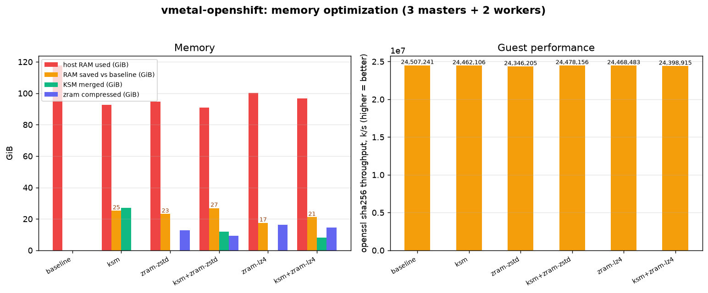

<div align="center">

# vmetal-openshift

**Virtual baremetal OpenShift, on a single KVM host.**

Redfish BMC emulation · agent, IPI &amp; UPI installs · bonded NICs + VLAN trunks · in-cluster
BareMetalHost power management, all from one data-driven Ansible topology.

[](https://github.com/maci0/vmetal-openshift/actions/workflows/lint.yml)


[Architecture](docs/architecture.md) ·
[Requirements](docs/requirements.md) ·
[IPI vs agent](docs/ipi-vs-agent.md) ·
[Fidelity](docs/fidelity.md) ·
[Disconnected](docs/disconnected.md) ·
[Variables](docs/variables.md) ·
[Examples](docs/examples.md) ·
[Memory](docs/memory-optimization.md) ·
[Virtualization](docs/virtualization.md) ·
[Resilience](docs/resilience.md) ·
[Cloud](docs/cloud.md) ·
[Troubleshooting](docs/troubleshooting.md)

</div>

---

## TL;DR

Virtual baremetal OpenShift on one KVM host: Redfish BMCs (sushy), bonded NICs +
VLAN trunks, two VIPs, metal3, MetalLB. One Ansible topology drives it all.

```bash
make check && make bootstrap      # host check + venv/deps/installer
make sushy-install                # start the Redfish BMC
make install CLUSTER=cluster0     # build ISO -> provision -> boot -> wait for the cluster
make status && make creds         # health + console/kubeadmin
```

`make` (no target) lists every command. New here? Read on; in a hurry? That's it.

---

**Goal: come as close as practical to a real baremetal OpenShift install** on a
single host, without the hardware. `sushy-tools` emulates Redfish BMCs on an
out-of-band LAN, libvirt VMs stand in for baremetal nodes (bonded NICs, jumbo-MTU
storage/migration VLANs), and the **agent-based** or **IPI** installer provisions them. Networks,
volumes, VMs, and the install configs are all rendered by Ansible from one
non-hardcoded topology. See [fidelity](docs/fidelity.md) for what is faithful vs
emulated.

## Highlights

- 🖥️ **Redfish BMC emulation** (sushy-tools): power + virtual media, per-node URLs
- 🔀 **Agent-based, IPI, and UPI** installs from the same derived topology (UPI is `platform: none`: ISO or PXE boot, host HAProxy for multi-node, metal3 adoption)
- 🧩 **Data-driven**: edit one `clusters` list; subnets, MACs, VIPs, bridges, UUIDs all computed
- 🪢 **Production NIC layout**: onboard bond + 4-port active-active VLAN trunk (storage + live-migration), jumbo MTU
- 🌐 **Two VIPs** (api / ingress) via integrated keepalived + HAProxy; libvirt split-DNS
- 🔀 **Real BGP peering** ([details](#-bgp-peering)): MetalLB speakers peer with an FRR router on the host over eBGP, off-link pool, ECMP multipath (`make metallb-bgp`). Plain L2/ARP too (`make metallb`)
- 💾 **Storage**: LVM Storage RWO (`make lvms`) + a host **NFS-Ganesha appliance** for RWX (`make nfs`)
- 🖧 **OpenShift Virtualization** (`make virt`): live migration on a dedicated VLAN ([docs](docs/virtualization.md))
- ⚡ **In-cluster BareMetalHost** power management (metal3 → Redfish → libvirt)
- 📡 **Disconnected**: `make mirror` (TLS registry on the gateway) + a `disconnected: true` switch injects the mirror into install-config ([docs](docs/disconnected.md))
- 📦 **Multi-cluster**: SNO, compact, dedicated workers, or SNO + day-2 workers (edge)
- 🛡️ **Resilience-tested**: bond, etcd-quorum, VIP, and node-drain failure drills ([docs](docs/resilience.md))
- 🧪 **Tested**: offline lint + render checks + live e2e; ansible-lint production profile


## Contents

[Prerequisites](#-prerequisites) ·
[Quick start](#-quick-start) ·
[How it fits together](#-how-it-fits-together) ·
[Topologies](#-cluster-topologies) ·
[Networks](#-networks) ·
[BGP peering](#-bgp-peering) ·
[DNS](#-dns) ·
[Install modes](#-install-modes) ·
[BMC control](#-bmc-control) ·
[Tests](#-tests) ·
[Layout](#-layout)

## ✅ Prerequisites

Host packages (the rest is installed into a venv by `make bootstrap`):

* **libvirt + qemu-kvm** with hardware virtualization (`/dev/kvm`)
* **OVMF / edk2** UEFI firmware (path auto-detected per distro)
* **NetworkManager** with the dnsmasq plugin (or systemd-resolved) for split-DNS
* **nmstate** (`nmstatectl`): needed to build an agent ISO with bonded/VLAN config
* **nested virtualization** (host `kvm_intel`/`kvm_amd` `nested=1`): only needed to
  run **OpenShift Virtualization** (VMs *on* the cluster). The node VMs already use
  CPU `host-passthrough` so the virt extensions are exposed. Enable on the host:
  `echo 'options kvm_intel nested=1' | sudo tee /etc/modprobe.d/kvm-nested.conf`
  (`kvm_amd` on AMD), then reload the module or reboot
* **Python 3** + `uv` (or `pip`), and `curl`, `jq`, `tar`, `openssl`
* a **pull secret** at `pull-secret.json` ([console.redhat.com](https://console.redhat.com/openshift/install/pull-secret))
* optional: `pandoc` / `mmdc` / `chromium` (docs PDF); `oc` or `kubectl` (`make adopt`)

Installed by `make bootstrap` (into `.venv` / `build/`): `sushy-tools`,
`ansible-core` + `community.libvirt` + `community.general`, `ansible-lint`,
`yamllint`, `libvirt-python`, `lxml`, and a pinned `openshift-install`.

Example (Fedora/RHEL):
```bash
sudo dnf install -y libvirt qemu-kvm edk2-ovmf NetworkManager-dnsmasq nmstate jq
```

**Host memory by mode** (VMs run concurrently on one host; vCPU oversubscribes,
RAM does not):

| Mode | VMs | RAM (lab default) | RAM (OpenShift minimums) |
|------|-----|-------------------|--------------------------|
| SNO (`control_plane: 1`, `workers: 0`) | 1 | ~34 GiB | ~18 GiB |
| Agent 3-node | 3 | ~98 GiB | ~52 GiB |
| IPI 3-node | 3 + bootstrap VM | ~114 GiB | ~68 GiB |
| each extra worker | +1 | +~32 GiB | +~10 GiB |

Defaults are 16 vCPU / 32 GiB / 128 + 1024 GiB (thin) per node; shrink via
per-cluster `memory_mib` / `vcpus` / `disks`. Run **`make check`** to verify the
host first. Full sizing in [docs/requirements.md](docs/requirements.md).

## 🚀 Quick start

```bash
make check                       # verify host prerequisites
make bootstrap                   # venv, deps, installer, cert
make sushy-install               # start the sushy Redfish BMC (systemd --user)
make install CLUSTER=cluster0    # one-shot: build ISO, provision, boot, wait for the cluster
make status                      # nodes + operators + BareMetalHosts
make creds                       # console URL + kubeadmin password
make down                        # tear everything down
```
`make` (no target) lists everything. A cluster declares `control_plane: 1`
(single-node/SNO) or `control_plane: 3` (HA), plus `workers: N`; `control_plane: 2`
(or any value other than 1 or 3) has no valid topology and is rejected up
front. Prefer step-by-step? `make iso` -> `make up` -> (redfish) `make bmc
BMC_ACTION=boot-iso` -> wait; `make install` just chains those.

## 🧭 How it fits together

1. **bootstrap** installs `sushy-tools`, `ansible-core`, the `community.libvirt`
   and `community.general` collections, a self-contained `openshift-install` in
   `build/openshift-install/`, and a TLS cert in `certs/`. Nothing touches system paths.
2. **topology** is derived from `ansible/group_vars/all.yml`. You normally edit
   only the `clusters` list:
   ```yaml
   clusters:
     - name: cluster0
       control_plane: 1
       workers: 0
     - name: prod
       control_plane: 3
       workers: 0
       install_mode: ipi
   ```
   Subnets, bridges, MACs, DHCP reservations, VIPs, node roles, replica counts,
   domain UUIDs, and BMC URLs are all computed from there.
3. **generate-configs** renders `clusters/<name>/install-config.yaml` plus, for
   agent clusters, `agent-config.yaml` and `baremetalhosts.yaml` (Day-2 BMC
   adoption). `build-iso.sh` wraps that and builds the agent ISO.
4. **setup.yml** creates the libvirt networks, volumes, and VMs.
5. **sushy-emulator** presents each VM as a Redfish BMC; `bmc.yml` powers nodes
   and mounts virtual media.

## 🗂 Cluster topologies

Each cluster declares its topology explicitly: `control_plane` (1 or 3) plus
`workers: N` (total nodes = `control_plane` + `workers`).
`masters_schedulable` (`auto`/`true`/`false`) controls whether workloads
run on the control plane.

| `control_plane` | `workers` | Masters | Workers | Masters schedulable | Notes |
|-----------------|-----------|---------|---------|---------------------|-------|
| 1 | 0 | 1 | 0 | yes (inherent) | single-node (SNO), `platform: none` |
| 3 | 0 | 3 | 0 | yes (`auto`) | compact, `platform: baremetal` |
| 3 | 2 | 3 | 2 | no (`auto`); `true` to override | dedicated workers |

`control_plane: 1` requires `workers: 0` (a single control plane cannot take
install-time workers); use `day2_workers: N` for an edge single control plane +
workers.

With workers present, `masters_schedulable: true` renders a day-1 `Scheduler`
manifest (`openshift/cluster-scheduler-02-config.yml`). Day-2 equivalent:
`oc patch scheduler cluster --type merge -p '{"spec":{"mastersSchedulable":true}}'`.

## 🌐 Networks

Per cluster, diverse RFC1918 blocks (`{c}` = cluster index):

| Network | Subnet | Carried on | Purpose |
|---------|--------|-----------|---------|
| `machine` | `10.{c}.0.0/24` | bond0 (untagged, NAT) | api + ingress VIP, DHCP, DNS, rendezvous |
| `provisioning` | `172.22.{c}.0/24` | bond0.20 (VLAN, onboard) | optional PXE (metal3 range) |
| `oob` | `172.16.{c}.0/24` | host only | BMC / Redfish management LAN |
| `storage` | `10.{c}.10.0/24` | bond1.30 (VLAN, jumbo) | storage (ODF/RWX) |
| `migration` | `10.{c}.20.0/24` | bond1.40 (VLAN, jumbo) | VM live-migration (CNV) |

Tidy host octets on the machine net: `.5` api VIP, `.6` ingress VIP, nodes from
`.10` (rendezvous `.10`), DHCP pool `.128-.254`. SNO collapses both VIPs onto the
node IP (no load balancer); multi-node uses `platform: baremetal` with the
integrated keepalived + HAProxy.

### NIC layout (configurable, `nic_layout`)

Mirrors an OpenShift Virtualization reference design: 2 onboard NICs bonded for the
machine network (provisioning VLAN on the same bond), plus a 4-port data card
bonded (active-active) as a VLAN trunk for storage + live-migration. A bond may
carry an untagged `network` and/or tagged `vlans` with real per-tag isolation.
Configure it in `ansible/group_vars/all.yml` (see [variables](docs/variables.md));
the [NIC diagram](docs/architecture.md#node-nic-layout-default-nic_layout) and
VLAN/L2 caveats are in the [architecture](docs/architecture.md) and
[fidelity](docs/fidelity.md) docs.

## 🔀 BGP peering

**Real BGP, not a mock.** `make metallb-bgp CLUSTER=<c>` stands up an **FRR router
on the host** (host-network container, `quay.io/frrouting/frr`) that **peers with
the MetalLB speaker on every node** and learns the LoadBalancer routes live.

- **eBGP session**: speakers in AS **64512** peer with the host FRR router in
  AS **64513**.
- **Off-link pool proves the route**: the LoadBalancer pool is TEST-NET-2
  (`198.51.{100+c}.0/24`), unreachable except via the BGP-learned path, so a
  successful `curl` to a service IP proves the session *and* the advertisement.
- **ECMP multipath**: FRR's `zebra` installs the learned `/32`s into the host
  kernel with equal-cost next-hops across all speakers, so traffic load-balances
  over the nodes and draining one withdraws only its next-hop.

```bash
make metallb-bgp CLUSTER=cluster0          # FRR router + BGP advertisement (ECMP)
make metallb-bgp-down CLUSTER=cluster0     # tear it down
```

ASNs and pools live in `ansible/group_vars/all.yml` (`metallb_bgp_*`). Plain L2
mode (`make metallb`, ARP) is also available, but BGP mode is the one that
exercises real routing and multipath, the way an upstream ToR would.

## 🔌 DNS

The machine network's dnsmasq is authoritative (`localOnly`) for the cluster domain
and answers `api` / `api-int` (API VIP) and `*.apps` (ingress VIP) for the **guests**
directly. To make the **host** resolve them too, point its resolver at that dnsmasq.
Enable the NetworkManager dnsmasq plugin once:
```bash
printf '[main]\ndns=dnsmasq\n' | sudo tee /etc/NetworkManager/conf.d/00-dnsmasq.conf
sudo systemctl restart NetworkManager
```
then add the per-cluster forward (writes `server=/<fqdn>/<machine-gateway>`):
```bash
make host-dns ANSIBLE_ARGS="-K"
```
Verify with `scripts/test-dns.sh`.

## 🛠 Install modes

* **agent** (default): boot the discovery ISO. `boot_via: iso` attaches it to the
  VM (no BMC); `boot_via: redfish` mounts it via sushy and powers on (enterprise
  path). BareMetalHost manifests are generated for Day-2 power control either way.
* **ipi**: `openshift-install create cluster` drives metal3 over Redfish; the
  install-config carries `platform.baremetal.hosts[]` with BMC + bond nmstate.
  `make iso` refuses IPI clusters and points you at `create cluster`.
* **upi**: `platform: none`, `make install-upi`. Single-node is bootstrap-in-place,
  booted via `boot_via`: `redfish`/`iso` embeds the ignition in the RHCOS live ISO
  (`coreos-installer`), or `pxe` netboots (UEFI -> `ipxe.efi` over TFTP -> iPXE ->
  RHCOS + ignition over HTTP, no media); api/ingress collapse onto the node IP, no
  LB. Multi-node (PXE only) adds a transient bootstrap node, a **host HAProxy**
  (`make haproxy`) for api/ingress, and CSR approval. PXE-installed nodes can be
  **adopted** by metal3 for power management (`make adopt`, `externallyProvisioned`
  BareMetalHosts). See [docs/ipi-vs-agent.md](docs/ipi-vs-agent.md#upi-user-provisioned).

See [docs/ipi-vs-agent.md](docs/ipi-vs-agent.md).

## ⚡ BMC control

```bash
make sushy                                   # render sushy/conf.py + unit + bmc-urls.txt
make bmc CLUSTER=cluster0 BMC_ACTION=on     # status | on | off | reset | boot-iso
make adopt CLUSTER=cluster0                  # in-cluster BMH power mgmt (baremetal only)
```
BMC URLs are `redfish-virtualmedia://172.16.<c>.1:8000/redfish/v1/Systems/<uuid>`.

## ⚡ Memory optimization

Every node runs the *same* RHCOS image, so most guest RAM is identical or cold.
`make optimize` turns three host features into a pipeline that lets a cluster's
nominal RAM far exceed what it actually consumes, without touching the host OS.
`make optimize-undo` reverts it.

```bash
make optimize        # KSM + zram + per-VM cgroup hook
make optimize-undo   # revert
```

How a page of guest RAM is handled, in order:

1. **KSM (dedup)** scans the VMs' active RAM and merges identical pages (zero
   pages, shared libs, the same RHCOS files across nodes) into one copy-on-write
   page. Shrinks the footprint before anything is compressed.
2. **cgroup wall (libvirt hook)** intercepts each VM at launch, finds its
   transient `machine-qemu-*.scope`, and caps its memory with `memory.high`. Host
   apps and services stay on raw RAM, unrestricted.
3. **The squeeze (`memory.high`)** caps the VM's *uncompressed* RAM. When it hits
   the cap the kernel reclaims that VM's coldest pages early instead of OOM-killing.
4. **zram (compress)** is the host swap: a compressed-RAM block device (zstd). The
   reclaimed cold pages compress into RAM, never touching disk.

Net effect: identical pages collapse (KSM), cold pages compress (zram), and the
host kernel does it transparently per-VM. (zram, not zswap: a single host with no
disk swap wants pure-RAM compression; zswap only helps with a disk-swap backstop.)

> Persist across reboots: `ksmtuned` for KSM, and a zram-generator config
> (`/etc/systemd/zram-generator.conf`) for the zram swap. `make check` warns when
> KSM is off.

### Validation (3 masters + 2 workers)

`make bench` runs a CPU workload (`openssl speed`) on the cluster under each
setting and records the VMs' memory + guest throughput; `scripts/plot-bench.py`
renders the chart. Memory is the VMs' actual resident set, summed from each qemu
scope's cgroup `memory.current` (not host `free`, which is polluted by page cache
and tmpfs). For an honest baseline it forces `vm.swappiness=0` and `swapoff`s zram
(no proactive swapping), unmerges KSM (`run=2`), and lets each optimization reach
steady state before measuring (KSM scans to convergence then dials down; zram fills
until eviction settles).



Measured on a 3 control-plane + 2 worker cluster (92 GiB allocated, 128 GiB host).
Footprint is the VMs' resident memory plus the cold pages held compressed in zram:

| setting | VM RSS | zram compr | **footprint** | **saved vs baseline** | KSM merged | ratio | CPU (M k/s) |
|---------|-------:|-----------:|--------------:|----------------------:|-----------:|:-----:|------------:|
| baseline | 83.6 GiB | 2.3 GiB | 85.9 GiB | n/a | 0 | n/a | 24.2 |
| KSM | 45.8 GiB | 0.3 GiB | **46.2 GiB** | **39.7 GiB** | 41.2 GiB | n/a | 24.4 |
| zram (zstd) | 29.0 GiB | 24.5 GiB | 53.5 GiB | **32.4 GiB** | 0 | **2.3×** | 24.6 |
| KSM + zram (zstd) | 28.2 GiB | 21.0 GiB | 49.2 GiB | **36.8 GiB** | 10.2 GiB | 2.3× | 24.4 |
| zram (lz4) | 27.6 GiB | 31.9 GiB | 59.5 GiB | **26.4 GiB** | 0 | 1.8× | 24.4 |
| KSM + zram (lz4) | 26.6 GiB | 29.1 GiB | 55.7 GiB | **30.2 GiB** | 9.2 GiB | 1.8× | 24.3 |

Takeaways:
* **KSM is the big win**: deduping the identical RHCOS pages drops the footprint from
  85.9 to **46.2 GiB (~46% less RAM)** at no measurable throughput cost. For identical
  nodes it is the single most effective setting.
* **zram on top of KSM does not help here** (KSM + zram-zstd 49.2 GiB vs KSM alone
  46.2 GiB): the squeeze pushes already-deduped pages into compressed swap, where they
  still cost RAM. zram earns its keep with non-identical nodes or when overcommitting
  past RAM. zstd compresses **~2.3×** vs lz4 **~1.8×**; zstd is the better default.
* **Performance is flat (~24.2-24.6M, <1.5% spread)** across all settings: at steady
  state KSM and zram cost ~0 throughput. (An *aggressive* KSM scan during the run cut
  perf ~4×, which is why the harness converges then dials KSM back before measuring.)

For the opposite case, where pages are compressible but *not* identical so zram wins
and KSM gets nothing, run `make bench-zram` (host-side, no cluster). See
[docs/memory-optimization.md](docs/memory-optimization.md#when-zram-beats-ksm).

## 🧪 Tests

```bash
make lint            # offline, CI-safe: syntax-check, ansible-lint, yamllint, shellcheck, render, config parse
make e2e             # live: provision, assert nets/domains/NIC bonding/DNS/Redfish, teardown
make bench           # memory/perf matrix: baseline / KSM / zram / KSM+zram
KEEP=1 scripts/e2e.sh
```

## 📁 Layout

```
Makefile                  check / bootstrap / configs / iso / sushy / host-dns / up / down / bmc / adopt / lint / e2e / pdf
scripts/                  bootstrap, install, build-iso, check-prereqs, adopt(.py), status, creds, test-dns, lint, e2e, export-pdf
build/                    downloaded installer + built ISOs (git-ignored)
certs/                    local TLS material for sushy (git-ignored)
ansible/                  see ansible/README.md for the full map
  group_vars/all.yml      addressing scheme + clusters (the file you edit)
  setup.yml cleanup.yml   provision / teardown
  generate-configs.yml    render install-config / agent-config / BareMetalHost / Scheduler
  sushy.yml bmc.yml       Redfish config + power / boot / virtual-media
  host-dns.yml            host split-DNS for the cluster domains
  dump-topology.yml       render derived topology to JSON (test oracle)
  templates/               topology.yml.j2 + libvirt/ + install/ + sushy/
  tasks/                  detect_ovmf, validate
tests/render_check.py     offline template + XML validation
docs/                     architecture, requirements, ipi-vs-agent, fidelity, disconnected, variables, examples, troubleshooting
```

## 📋 TODO

* macOS host support
* mirror operator catalogs (`oc-mirror`) for fully air-gapped Day-2 operators
  (the release payload is covered, see [docs/disconnected.md](docs/disconnected.md))

## License

[MIT](LICENSE)
