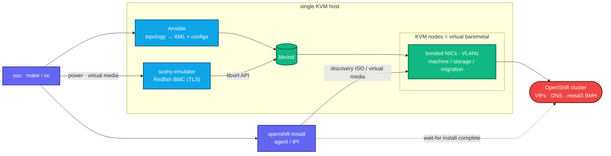

<div align="center">

# vmetal-openshift

**Virtual baremetal OpenShift, on a single KVM host.**

Redfish BMC emulation · agent &amp; IPI installs · bonded NICs + VLAN trunks · in-cluster
BareMetalHost power management, all from one data-driven Ansible topology.


[Architecture](docs/architecture.md) ·
[Requirements](docs/requirements.md) ·
[IPI vs agent](docs/ipi-vs-agent.md) ·
[Fidelity](docs/fidelity.md) ·
[Disconnected](docs/disconnected.md) ·
[Variables](docs/variables.md) ·
[Examples](docs/examples.md) ·
[Troubleshooting](docs/troubleshooting.md)

</div>

---

`sushy-tools` emulates Redfish BMCs on an out-of-band LAN, libvirt VMs stand in for
baremetal nodes (bonded NICs, jumbo storage), and the **agent-based** or **IPI**
installer provisions them. Networks, volumes, VMs, and the install configs are all
rendered by Ansible from one non-hardcoded topology.

## Highlights

- 🖥️ **Redfish BMC emulation** (sushy-tools): power + virtual media, per-node URLs
- 🔀 **Agent-based and IPI** installs from the same derived topology
- 🧩 **Data-driven**: edit one `clusters` list; subnets, MACs, VIPs, bridges, UUIDs all computed
- 🪢 **Production NIC layout**: onboard bond + 4-port active-active VLAN trunk (storage + live-migration), jumbo MTU
- 🌐 **Two VIPs** (api / ingress) via integrated keepalived + HAProxy; libvirt split-DNS
- ⚡ **In-cluster BareMetalHost** power management (metal3 → Redfish → libvirt)
- 📦 **Multi-cluster**: SNO, compact, or dedicated workers; schedulable masters
- 🧪 **Tested**: offline lint + render checks + live e2e; ansible-lint production profile



## Contents

[Prerequisites](#-prerequisites) ·
[Quick start](#-quick-start) ·
[How it fits together](#-how-it-fits-together) ·
[Topologies](#-cluster-topologies) ·
[Networks](#-networks) ·
[DNS](#-dns) ·
[Install modes](#-install-modes) ·
[BMC control](#-bmc-control) ·
[Tests](#-tests) ·
[Layout](#-layout)

## ✅ Prerequisites

Host packages (the rest is installed into a venv by `make bootstrap`):

* **libvirt + qemu-kvm** with hardware virtualization (`/dev/kvm`)
* **OVMF / edk2** UEFI firmware (path auto-detected per distro)
* **NetworkManager** with the dnsmasq plugin (or systemd-resolved) for split-DNS
* **nmstate** (`nmstatectl`): needed to build an agent ISO with bonded/VLAN config
* **Python 3** + `uv` (or `pip`), and `curl`, `jq`, `tar`, `openssl`
* a **pull secret** at `pull-secret.json` ([console.redhat.com](https://console.redhat.com/openshift/install/pull-secret))
* optional: `pandoc` / `mmdc` / `chromium` (docs PDF); `oc` or `kubectl` (`make adopt`)

Installed by `make bootstrap` (into `.venv` / `build/`): `sushy-tools`,
`ansible-core` + `community.libvirt` + `community.general`, `ansible-lint`,
`yamllint`, `libvirt-python`, `lxml`, and a pinned `openshift-install`.

Example (Fedora/RHEL):
```bash
sudo dnf install -y libvirt qemu-kvm edk2-ovmf NetworkManager-dnsmasq nmstate jq
```
Run **`make check`** to verify everything first. Full sizing in
[docs/requirements.md](docs/requirements.md).

## 🚀 Quick start

```bash
make check                      # verify host prerequisites
make bootstrap                  # venv, deps, installer, cert
make iso CLUSTER=cluster0       # render configs + build the agent discovery ISO
make sushy                      # render the sushy Redfish config + unit
make up ANSIBLE_ARGS="-e use_become=false"   # provision libvirt (in the libvirt group)
make down                       # tear everything down
```
`make help` lists every target. A cluster must be single-node (`node_count: 1`) or
`>= 3`; a 2-node cluster has no valid control-plane topology and is rejected up front.

## 🧭 How it fits together

1. **bootstrap** installs `sushy-tools`, `ansible-core`, the `community.libvirt`
   and `community.general` collections, a self-contained `openshift-install` in
   `build/openshift-install/`, and a TLS cert in `certs/`. Nothing touches system paths.
2. **topology** is derived from `ansible/group_vars/all.yml`. You normally edit
   only the `clusters` list:
   ```yaml
   clusters:
     - name: cluster0
       node_count: 1
     - name: prod
       node_count: 3
       install_mode: ipi
   ```
   Subnets, bridges, MACs, DHCP reservations, VIPs, node roles, replica counts,
   domain UUIDs, and BMC URLs are all computed from there.
3. **generate-configs** renders `clusters/<name>/install-config.yaml` plus, for
   agent clusters, `agent-config.yaml` and `baremetalhosts.yaml` (Day-2 BMC
   adoption). `build-iso.sh` wraps that and builds the agent ISO.
4. **setup.yml** creates the libvirt networks, volumes, and VMs.
5. **sushy-emulator** presents each VM as a Redfish BMC; `bmc.yml` powers nodes
   and mounts virtual media.

## 🗂 Cluster topologies

`node_count` plus `control_plane_count` (1 or 3) decide the shape; the rest are
workers. `masters_schedulable` (`auto`/`true`/`false`) controls whether workloads
run on the control plane.

| `node_count` | Masters | Workers | Masters schedulable | Notes |
|--------------|---------|---------|---------------------|-------|
| 1 | 1 | 0 | yes (inherent) | single-node (SNO), `platform: none` |
| 3 | 3 | 0 | yes (`auto`) | compact, `platform: baremetal` |
| 5 | 3 | 2 | no (`auto`); `true` to override | dedicated workers |

With workers present, `masters_schedulable: true` renders a day-1 `Scheduler`
manifest (`openshift/cluster-scheduler-02-config.yml`). Day-2 equivalent:
`oc patch scheduler cluster --type merge -p '{"spec":{"mastersSchedulable":true}}'`.

## 🌐 Networks

Per cluster, diverse RFC1918 blocks (`{c}` = cluster index):

| Network | Subnet | Carried on | Purpose |
|---------|--------|-----------|---------|
| `machine` | `10.{c}.0.0/24` | bond0 (untagged, NAT) | api + ingress VIP, DHCP, DNS, rendezvous |
| `provisioning` | `172.22.{c}.0/24` | bond0.20 (VLAN, onboard) | optional PXE (metal3 range) |
| `oob` | `172.16.{c}.0/24` | host only | BMC / Redfish management LAN |
| `storage` | `10.{c}.10.0/24` | bond1.30 (VLAN, jumbo) | storage (ODF/RWX) |
| `migration` | `10.{c}.20.0/24` | bond1.40 (VLAN, jumbo) | VM live-migration (CNV) |

Tidy host octets on the machine net: `.5` api VIP, `.6` ingress VIP, nodes from
`.10` (rendezvous `.10`), DHCP pool `.128-.254`. SNO collapses both VIPs onto the
node IP (no load balancer); multi-node uses `platform: baremetal` with the
integrated keepalived + HAProxy.

### NIC layout (configurable, `nic_layout`)

Mirrors an OpenShift Virtualization reference design: 2 onboard NICs bonded for the
machine network (provisioning VLAN on the same bond), plus a 4-port data card
bonded (active-active) as a VLAN trunk for storage + live-migration. A bond may
carry an untagged `network` and/or tagged `vlans` with real per-tag isolation.
Configure it in `ansible/group_vars/all.yml` (see [variables](docs/variables.md));
the [NIC diagram](docs/architecture.md#node-nic-layout-default-nic_layout) and
VLAN/L2 caveats are in the [architecture](docs/architecture.md) and
[fidelity](docs/fidelity.md) docs.

## 🔌 DNS

The machine network's dnsmasq is authoritative (`localOnly`) for the cluster domain
and answers `api` / `api-int` (API VIP) and `*.apps` (ingress VIP) for the **guests**
directly. To make the **host** resolve them too, point its resolver at that dnsmasq.
Enable the NetworkManager dnsmasq plugin once:
```bash
printf '[main]\ndns=dnsmasq\n' | sudo tee /etc/NetworkManager/conf.d/00-dnsmasq.conf
sudo systemctl restart NetworkManager
```
then add the per-cluster forward (writes `server=/<fqdn>/<machine-gateway>`):
```bash
make host-dns ANSIBLE_ARGS="-K"
```
Verify with `scripts/test-dns.sh`.

## 🛠 Install modes

* **agent** (default): boot the discovery ISO. `boot_via: iso` attaches it to the
  VM (no BMC); `boot_via: redfish` mounts it via sushy and powers on (enterprise
  path). BareMetalHost manifests are generated for Day-2 power control either way.
* **ipi**: `openshift-install create cluster` drives metal3 over Redfish; the
  install-config carries `platform.baremetal.hosts[]` with BMC + bond nmstate.
  `make iso` refuses IPI clusters and points you at `create cluster`.

See [docs/ipi-vs-agent.md](docs/ipi-vs-agent.md).

## ⚡ BMC control

```bash
make sushy                                   # render sushy/conf.py + unit + bmc-urls.txt
make bmc CLUSTER=cluster0 BMC_ACTION=on     # status | on | off | reset | boot-iso
make adopt CLUSTER=cluster0                  # in-cluster BMH power mgmt (baremetal only)
```
BMC URLs are `redfish-virtualmedia://172.16.<c>.1:8000/redfish/v1/Systems/<uuid>`.

## 🧪 Tests

```bash
make lint            # offline, CI-safe: syntax-check, ansible-lint, yamllint, shellcheck, render, config parse
make e2e             # live: provision, assert nets/domains/NIC bonding/DNS/Redfish, teardown
KEEP=1 scripts/e2e.sh
```

## 📁 Layout

```
Makefile                  check / bootstrap / configs / iso / sushy / host-dns / up / down / bmc / adopt / lint / e2e / pdf
scripts/                  bootstrap, build-iso, check-prereqs, adopt, test-dns, lint, e2e, export-pdf
build/                    downloaded installer + built ISOs (git-ignored)
certs/                    local TLS material for sushy (git-ignored)
ansible/                  see ansible/README.md for the full map
  group_vars/all.yml      addressing scheme + clusters (the file you edit)
  setup.yml cleanup.yml   provision / teardown
  generate-configs.yml    render install-config / agent-config / BareMetalHost / Scheduler
  sushy.yml bmc.yml       Redfish config + power / boot / virtual-media
  host-dns.yml            host split-DNS for the cluster domains
  dump-topology.yml       render derived topology to JSON (test oracle)
  templates/               topology.yml.j2 + libvirt/ + install/ + sushy/
  tasks/                  detect_ovmf, validate
tests/render_check.py     offline template + XML validation
docs/                     architecture, requirements, ipi-vs-agent, fidelity, disconnected, variables, examples, troubleshooting
```

## 📋 TODO

* macOS host support
* first-class disconnected switch (see [docs/disconnected.md](docs/disconnected.md))
