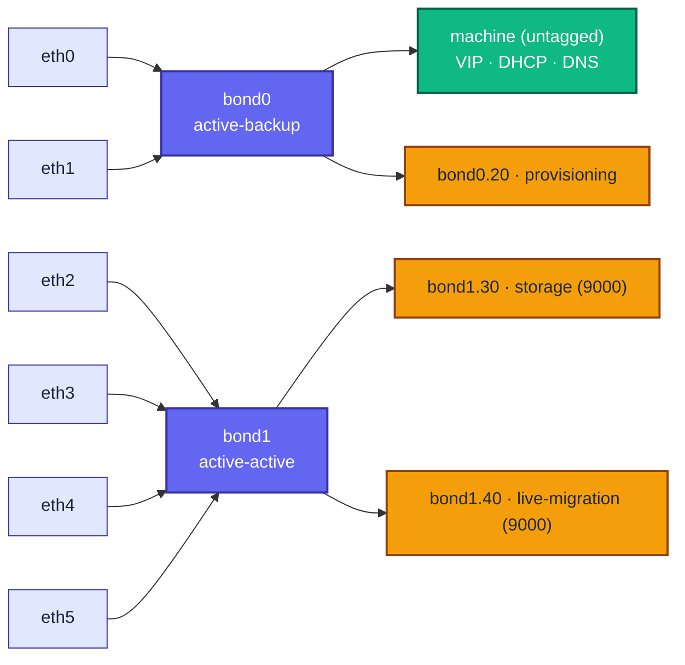

# vmetal-openshift

Virtual **baremetal OpenShift** lab on a single KVM host (virtual "metal"). `sushy-tools` emulates
Redfish BMCs on an out-of-band LAN, libvirt VMs stand in for baremetal nodes
(bonded NICs, jumbo storage), and either the **agent-based** or **IPI** installer
provisions them. Networks, volumes, VMs, and the install configs are all rendered
by Ansible from one data-driven, non-hardcoded topology.

Docs: [architecture](docs/architecture.md) (more diagrams),
[requirements + sizing](docs/requirements.md),
[IPI vs agent](docs/ipi-vs-agent.md), [fidelity / limitations](docs/fidelity.md),
[disconnected](docs/disconnected.md), [variables](docs/variables.md),
[rendered examples](docs/examples.md), [troubleshooting](docs/troubleshooting.md).


## Quick start

```bash
make check                      # verify host prerequisites
make bootstrap                  # venv, deps, installer, cert
make iso CLUSTER=cluster0       # render configs + build the agent discovery ISO
make sushy                      # render the sushy Redfish config + unit
make up ANSIBLE_ARGS="-e use_become=false"   # provision libvirt (in the libvirt group)
make down                       # tear everything down
```
`make help` lists every target. Each cluster must be single-node
(`node_count: 1`) or `>= 3`; a 2-node cluster has no valid control-plane topology
and is rejected up front.

## How it fits together

1. **bootstrap** installs `sushy-tools`, `ansible-core`, the `community.libvirt`
   and `community.general` collections, a self-contained `openshift-install` in
   `build/openshift-install/`, and a TLS cert in `certs/`. Nothing touches system paths.
2. **topology** is derived from `ansible/group_vars/all.yml`. You normally edit
   only the `clusters` list:
   ```yaml
   clusters:
     - name: cluster0
       node_count: 1
     - name: prod
       node_count: 3
       install_mode: ipi
   ```
   Subnets, bridges, MACs, DHCP reservations, VIPs, node roles, replica counts,
   domain UUIDs, and BMC URLs are all computed from there.
3. **generate-configs** renders `clusters/<name>/install-config.yaml` plus, for
   agent clusters, `agent-config.yaml` and `baremetalhosts.yaml` (Day-2 BMC
   adoption). `build-iso.sh` wraps that and builds the agent ISO.
4. **setup.yml** creates the libvirt networks, volumes, and VMs.
5. **sushy-emulator** presents each VM as a Redfish BMC; `boot.yml` powers nodes
   and mounts virtual media.

## Cluster topologies

`node_count` plus `control_plane_count` (1 or 3) decide the shape; the rest are
workers. `masters_schedulable` (`auto`/`true`/`false`) controls whether workloads
run on the control plane.

| `node_count` | Masters | Workers | Masters schedulable | Notes |
|--------------|---------|---------|---------------------|-------|
| 1 | 1 | 0 | yes (inherent) | single-node (SNO), `platform: none` |
| 3 | 3 | 0 | yes (`auto`) | compact, `platform: baremetal` |
| 5 | 3 | 2 | no (`auto`); `true` to override | dedicated workers |

With workers present, `masters_schedulable: true` renders a day-1 `Scheduler`
manifest (`openshift/cluster-scheduler-02-config.yml`). Day-2 equivalent:
`oc patch scheduler cluster --type merge -p '{"spec":{"mastersSchedulable":true}}'`.

## Networks (per cluster, diverse RFC1918)

| Network | Subnet | Carried on | Purpose |
|---------|--------|-----------|---------|
| `machine` | `10.{c}.0.0/24` | bond0 (untagged, NAT) | api + ingress VIP, DHCP, DNS, rendezvous |
| `provisioning` | `172.22.{c}.0/24` | bond0.20 (VLAN, onboard) | optional PXE (metal3 range) |
| `oob` | `172.16.{c}.0/24` | host only | BMC / Redfish management LAN |
| `storage` | `10.{c}.10.0/24` | bond1.30 (VLAN, jumbo) | storage (ODF/RWX) |
| `migration` | `10.{c}.20.0/24` | bond1.40 (VLAN, jumbo) | VM live-migration (CNV) |

Tidy host octets on the machine net: `.5` api VIP, `.6` ingress VIP, nodes from
`.10` (rendezvous `.10`), DHCP pool `.128-.254`. SNO collapses both VIPs onto the
node IP (no load balancer); multi-node uses `platform: baremetal` with the
integrated keepalived + HAProxy.

### NIC layout (configurable, `nic_layout`)

Mirrors an OpenShift Virtualization reference design: 2 onboard NICs bonded for
the machine network (with the provisioning VLAN on the same onboard bond), plus a
4-port data card bonded (active-active) as a VLAN trunk for storage +
live-migration. A bond attaches to one libvirt network (its `network`'s bridge,
or an L2 `trunk`) and may carry an untagged `network` and/or tagged `vlans` (real
guest-to-guest isolation per tag).

```yaml
nic_layout:
  - bond: bond0           # onboard
    nics: 2
    mode: active-backup
    network: machine      # untagged primary
    vlans:
      - { network: provisioning, id: 20 }
  - bond: bond1           # 4-port data card
    nics: 4
    mode: balance-alb     # active-active; use 802.3ad with a real switch
    trunk: trunk
    vlans:
      - { network: storage, id: 30 }
      - { network: migration, id: 40 }
```
Edit it to change NIC counts, bonds, modes, or which networks ride which bond.
See [fidelity.md](docs/fidelity.md) for the VLAN/L2 caveats.



## DNS (libvirt only)

The machine network's dnsmasq is authoritative (`localOnly`) for the cluster
domain and answers `api` / `api-int` (API VIP) and `*.apps` (ingress VIP) for the
**guests** directly. To make the **host** resolve them too, its resolver must
forward the cluster domain to that dnsmasq. Enable the NetworkManager dnsmasq
plugin once:
```bash
printf '[main]\ndns=dnsmasq\n' | sudo tee /etc/NetworkManager/conf.d/00-dnsmasq.conf
sudo systemctl restart NetworkManager
```
then add the per-cluster forward (writes `server=/<fqdn>/<machine-gateway>`):
```bash
make host-dns ANSIBLE_ARGS="-K"
```
Verify with `scripts/test-dns.sh`.

## Install modes

* **agent** (default): boot the discovery ISO. `boot_via: iso` attaches it to the
  VM (no BMC); `boot_via: redfish` mounts it via sushy and powers on (enterprise
  path). BareMetalHost manifests are generated for Day-2 power control either way.
* **ipi**: `openshift-install create cluster` drives metal3 over Redfish; the
  install-config carries `platform.baremetal.hosts[]` with BMC + bond nmstate.
  `make iso` refuses IPI clusters and points you at `create cluster`.

See [docs/ipi-vs-agent.md](docs/ipi-vs-agent.md).

## BMC control

```bash
make sushy                                   # render sushy/conf.py + unit + bmc-urls.txt
make boot CLUSTER=cluster0 BMC_ACTION=on     # status | on | off | reset | boot-iso
```
BMC URLs are `redfish-virtualmedia://172.16.<c>.1:8000/redfish/v1/Systems/<uuid>`.

## Tests

```bash
make lint            # offline, CI-safe: syntax-check, yamllint, shellcheck, render, config parse
make e2e             # live: provision, assert nets/domains/NIC bonding/DNS/Redfish, teardown
KEEP=1 scripts/e2e.sh
```

## Layout

```
Makefile                  check / bootstrap / configs / iso / sushy / up / down / boot / adopt / lint / e2e / pdf
scripts/                  bootstrap, build-iso, check-prereqs, adopt, host-dns(via ansible), test-dns, lint, e2e, export-pdf
build/                    downloaded installer + built ISOs (git-ignored)
certs/                    local TLS material for sushy (git-ignored)
ansible/
  group_vars/all.yml      addressing scheme + clusters (the file you edit)
  setup.yml cleanup.yml   provision / teardown
  generate-configs.yml    render install-config / agent-config / BareMetalHost
  sushy.yml boot.yml      Redfish config + power/virtual-media
  dump-topology.yml       render derived topology to JSON (test oracle)
  templates/*.j2          topology, libvirt XML, install/agent configs, nmstate macro
  tasks/                  detect_ovmf, validate
tests/render_check.py     offline template + XML validation
docs/                     architecture, requirements, ipi-vs-agent, fidelity, disconnected, variables, troubleshooting
```

## TODO
* macOS
* first-class disconnected switch (see docs/disconnected.md)
