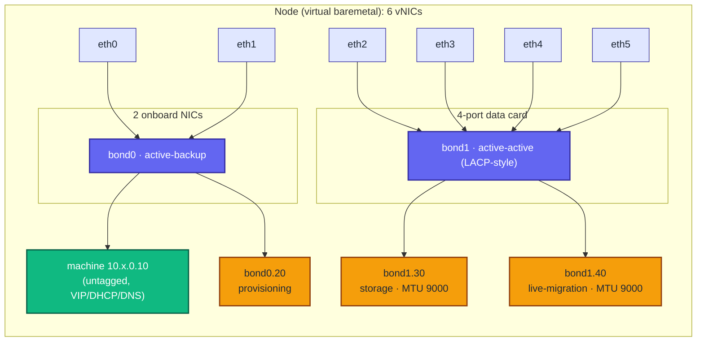
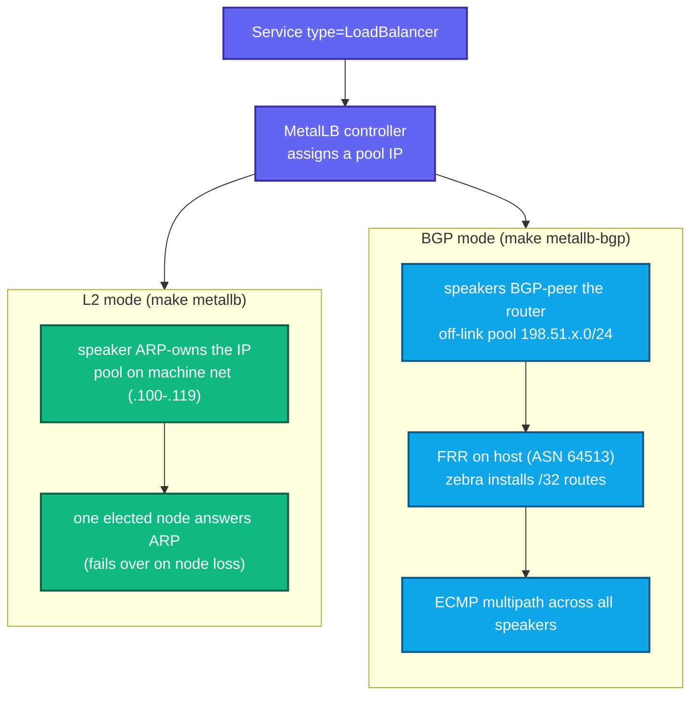
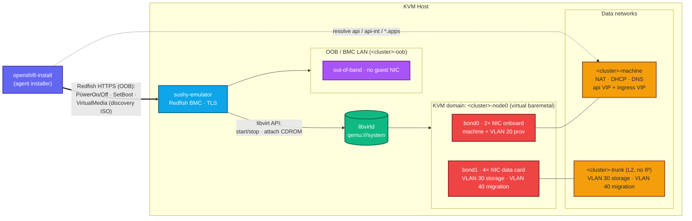
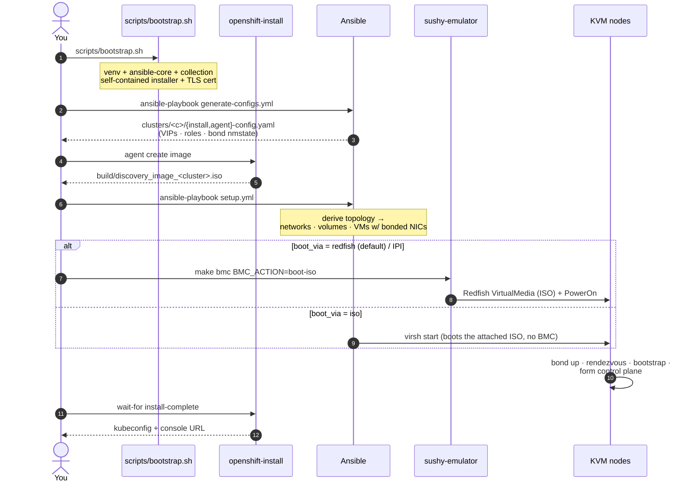
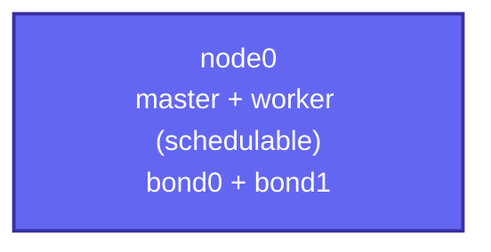
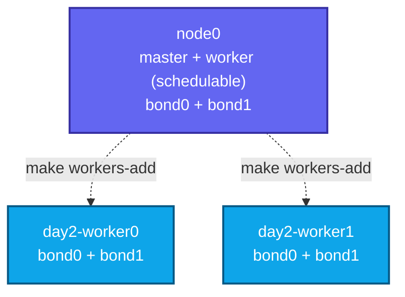
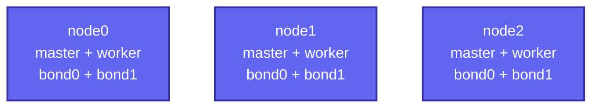
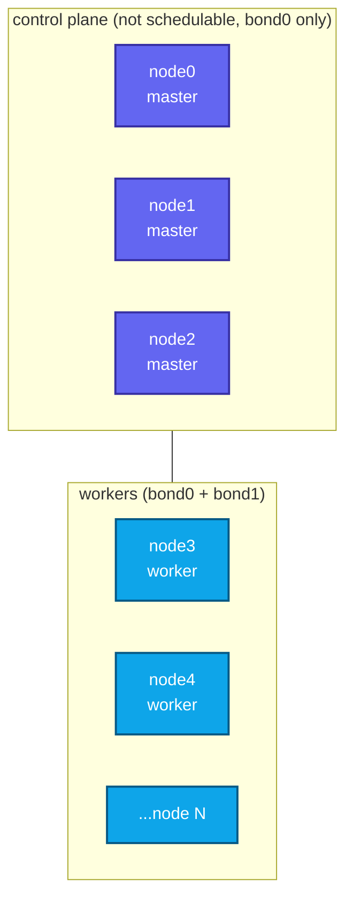
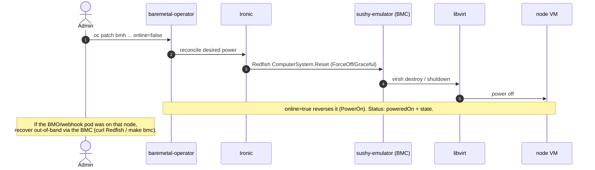
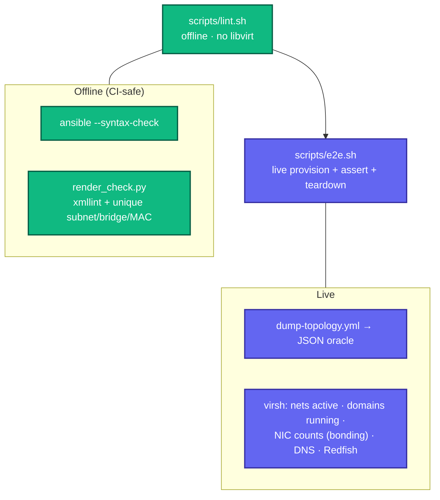

# Architecture & Flow

[Home](../README.md) · **Architecture** · [Requirements](requirements.md) · [IPI vs agent](ipi-vs-agent.md) · [Fidelity](fidelity.md) · [Disconnected](disconnected.md) · [Variables](variables.md) · [Examples](examples.md) · [Memory](memory-optimization.md) · [Troubleshooting](troubleshooting.md)

How the pieces fit: per-cluster networks, the node NIC/bond/VLAN layout, the
sushy Redfish emulation, the install flow, cluster topologies, BMC power
management, and the test layers. Diagrams render in light and dark mode.

## Networks

Each cluster gets a block of isolated libvirt networks, one per role (derived,
never hardcoded, see `ansible/group_vars/all.yml`):

| Network | Subnet (cluster `{c}`) | Carried on | Purpose |
|---------|------------------------|-----------|---------|
| `machine` | `10.{c}.0.0/24` | **bond0** (2 NICs onboard, untagged, NAT) | API + ingress VIP, DHCP, DNS, rendezvous |
| `provisioning` | `172.22.{c}.0/24` | **bond0.20** (VLAN, onboard) | optional PXE (metal3 range) |
| `oob` | `172.16.{c}.0/24` | host only (no guest NIC) | BMC / Redfish management LAN |
| `storage` | `10.{c}.10.0/24` | **bond1.30** (VLAN, MTU 9000) | storage (ODF/RWX) |
| `migration` | `10.{c}.20.0/24` | **bond1.40** (VLAN, MTU 9000) | VM live-migration (CNV) |

Diverse RFC1918 blocks per network (production-like), not one flat `192.168/16`.
The default `nic_layout` mirrors an OpenShift Virtualization reference design: a
2-NIC onboard bond (machine + provisioning VLAN) plus a 4-port data card
(`bond1`, active-active) carrying storage + live-migration VLANs. Cluster 0 →
`10.0.0.0/24`, cluster 1 → `10.1.0.0/24`, etc.

The data-plane card (`bond1`, `roles: [worker]`) is attached only to nodes that
run workloads: workers, and schedulable control-plane nodes (compact / SNO).
**Non-schedulable control-plane nodes get only `bond0`** (machine + provisioning),
no storage/live-migration NICs, matching a real split design.

### Node NIC layout (default `nic_layout`)

This is the full layout (6 vNICs), used by workers and schedulable control-plane
nodes. Non-schedulable control-plane nodes get only `bond0` (eth0/eth1), no `bond1`
storage/migration card.

### VIPs & load balancing

Two VIPs on the machine net, baremetal-style:

* **API VIP** (`api_vip_offset`), `api` / `api-int` (6443, 22623)
* **Ingress VIP** (`ingress_vip_offset`), `*.apps` (80, 443)

With `platform: baremetal` (what the agent-based installer uses on-prem),
OpenShift runs its **own** load balancer for these, `keepalived` floats each VIP
to a live node, `HAProxy` balances across the control plane / ingress nodes. No
external LB appliance. For single-node (SNO) both VIPs collapse onto the node IP
and there is no LB. An external HAProxy is only needed for `platform: none`.

> Agent-based note: unlike IPI/metal3, the agent-based installer does **not**
> require a provisioning network, nodes boot the discovery ISO via **virtual
> media over the OOB/Redfish LAN**. The provisioning net is kept for realism and
> can be set to `nics: 0` to drop it.

### LoadBalancer services (MetalLB)

The VIPs cover the API and ingress. For app `Service type=LoadBalancer` (no cloud
LB on baremetal) the lab runs **MetalLB**, in either mode:

L2 needs no router (ARP, single owner). BGP uses an off-link pool so reachability
*requires* the BGP route, and gets ECMP load-spreading + fast failover.

## Sushy Redfish emulation

`openshift-install` thinks it is driving real baremetal BMCs over the **OOB LAN**.
`sushy-emulator` exposes a **Redfish API** (TLS) and translates power /
virtual-media calls into **libvirt** operations. The KVM domains *are* the
"baremetal" nodes, each with **bonded NICs** on the data networks.

## Install flow

End-to-end, from a bare host to a running cluster.

## Cluster topologies

Four supported shapes. A node that runs workloads (worker, or schedulable master)
gets the full NIC layout (`bond0` + `bond1`); a non-schedulable master gets only
`bond0` (no storage/migration). Blue = control plane, cyan = worker.

### SNO (`node_count: 1`)

Single node, control plane + workloads on one box. Both VIPs collapse onto the
node IP; schedulable, so it has the full NIC layout.

### SNO + day-2 workers (`node_count: 1`, `day2_workers: N`)

Edge shape: one control-plane node, workers joined after install with
`make workers-add` (`oc adm node-image`). Single etcd, so the control plane stays
at one; workers scale out.

### 3-node compact (`node_count: 3`)

Three masters, **schedulable** (auto, no separate workers), so workloads run on
the control plane. All three carry the full NIC layout.

### 3 + N workers (`node_count: 3+N`)

Three dedicated masters, **not schedulable** (so `bond0` only, no storage/migration
card), plus N workers that run the workloads with the full NIC layout. Set
`masters_schedulable: true` to override.

## BMC power management (metal3 → Redfish → libvirt)

Setting `online` on a `BareMetalHost` (or `make bmc`) drives the whole emulated
chain. This is what powered node2 off/on in the lab.

## Test layers

