# Disconnected (air-gapped) install

<sub>[Home](../README.md) · [Architecture](architecture.md) · [Requirements](requirements.md) · [IPI vs agent](ipi-vs-agent.md) · [Fidelity](fidelity.md) · **Disconnected** · [Variables](variables.md) · [Examples](examples.md) · [Memory](memory-optimization.md) · [Virtualization](virtualization.md) · [Resilience](resilience.md) · [Cloud](cloud.md) · [Troubleshooting](troubleshooting.md)</sub>

By default the machine network NATs to the host uplink, so the lab is
**connected**: nodes pull the release payload and operator images from the
internet. Production baremetal is frequently disconnected. A `disconnected: true`
switch plus `make mirror` (release payload) and `make mirror-operators` (operator
catalogs) wire up a full air gap: install and Day-2 operators both from the host
registry.

<p align="center">
  <picture>
    <source media="(prefers-color-scheme: dark)" srcset="diagrams/disconnected-01-dark.svg">
    
  </picture>
</p>

## What disconnected needs

1. **A mirror registry** reachable by the cluster (and the installer host):
   `mirror-registry` (mini Quay) or any registry, with TLS.
2. **Mirrored content** via `oc-mirror` (v2) or `oc adm release mirror`:
   * the OpenShift release payload for the target version
   * operator catalog(s) and any operators you need
   * additional images (samples, must-gather) as desired
3. **install-config additions**:
   * `imageDigestSources` (or an `ImageDigestMirrorSet` manifest) mapping the
     upstream registries to your mirror
   * `additionalTrustBundle`: the mirror registry CA PEM
   * the pull secret restricted to the mirror (plus Red Hat entitlement for
     mirroring)
4. **Local infra on the management/OOB side**:
   * DNS (already provided by libvirt dnsmasq here)
   * NTP from a local source (set `ntp_servers` to an internal host, not a pool)
   * an HTTP server for boot artifacts if you use a minimal ISO / PXE
5. **Telemetry disabled** (no Insights/phone-home) and any proxy via
   install-config `proxy:` if egress is through one.

## Doing it in this lab

The automated path is two commands:

```bash
make mirror CLUSTER=cluster0     # registry on the gateway + mirror the release
# set `disconnected: true` in group_vars, then build/install as usual
```

Each step and its manual equivalent follow, so you can customize or do it by hand.

### 1. Mirror the release (`make mirror`)

`scripts/mirror.sh` does three things (substitute your cluster's machine gateway
for `GW`):

**a. A TLS cert** for the registry, valid for the gateway IP (it is its own CA,
injected later as the trust bundle):

```bash
GW=10.0.0.1
mkdir -p certs/mirror
openssl req -x509 -newkey rsa:4096 -nodes -days 3650 \
  -keyout certs/mirror/key.pem -out certs/mirror/cert.pem -subj "/CN=$GW" \
  -addext "subjectAltName=IP:${GW},IP:127.0.0.1,DNS:localhost"
cp certs/mirror/cert.pem certs/mirror/ca.pem
```

**b. The registry** on the host network, reachable at `<gw>:5000` from the nodes
(a host appliance, like NFS-Ganesha / FRR / HAProxy):

```bash
docker rm -f vmetal-mirror 2>/dev/null || true   # re-run safe
docker run -d --name vmetal-mirror --network host \
  -v "$PWD/build/mirror/data:/var/lib/registry:Z" -v "$PWD/certs/mirror:/certs:ro,Z" \
  -e REGISTRY_HTTP_ADDR=0.0.0.0:5000 \
  -e REGISTRY_HTTP_TLS_CERTIFICATE=/certs/cert.pem \
  -e REGISTRY_HTTP_TLS_KEY=/certs/key.pem \
  docker.io/library/registry:2
```

**c. The mirror** itself, using your pull secret for quay.io (`--insecure` skips
TLS verify against the self-signed registry):

```bash
VER=4.22.0
oc adm release mirror --insecure \
  --registry-config=pull-secret.json \
  --from="quay.io/openshift-release-dev/ocp-release:${VER}-x86_64" \
  --to="${GW}:5000/openshift/release" \
  --to-release-image="${GW}:5000/openshift/release:${VER}"
```

This pulls ~20-30 GB and prints the `imageContentSources` mapping it created.
`make mirror-down` stops the registry; `OCP_VERSION=...` overrides the version.

### 2. Inject the mirror into install-config (`disconnected: true`)

Set `disconnected: true` (global in `group_vars`, or per cluster) and
`generate-configs` adds the block below to the agent and IPI install-configs. To
do it by hand, paste it into the generated `clusters/<c>/install-config.yaml`:

```yaml
imageDigestSources:
- mirrors:
  - 10.0.0.1:5000/openshift/release
  source: quay.io/openshift-release-dev/ocp-v4.0-art-dev
- mirrors:
  - 10.0.0.1:5000/openshift/release
  source: quay.io/openshift-release-dev/ocp-release
additionalTrustBundle: |
  -----BEGIN CERTIFICATE-----
  ... contents of certs/mirror/ca.pem ...
  -----END CERTIFICATE-----
```

### 3. Cut the cord (optional, for a true air gap)

Change the machine network's `kind` from `nat` to `isolated` in the `networks`
map. `isolated` renders a libvirt network with no forward, keeping DHCP/DNS but
no route out:

```yaml
networks:
  machine: { cidr: "10.{c}.0.0/24", kind: isolated, dns: true }
```

### 4. Build and install

As usual (`make iso` / `make install` / `make install-upi`); the nodes now pull
the release from the mirror.

## Day-2 operators (air-gapped)

`make mirror` covers the **release payload** (the install). The Day-2 operators
(MetalLB, LVMS, CNV) come from the operator catalog, which `make mirror-operators`
mirrors with `oc-mirror` (v2):

1. Set `disconnected: true` on the cluster and `ocp_minor: "4.22"` (your release's
   minor) in `group_vars/all.yml`, then `make configs`. This renders, per cluster:
   * `imageset-config.yaml` (the `ImageSetConfiguration`: the operator index +
     the lvms / metallb / kubevirt-hyperconverged / mtv packages), and
   * `operator-catalog.yaml` (a `CatalogSource` named `vmetal-operators` backed by
     the mirrored index, plus an `ImageDigestMirrorSet` redirecting the Red Hat
     operator registries to the host mirror).
2. `make mirror CLUSTER=c` then `make mirror-operators CLUSTER=c` populate the host
   registry (release, then operators via oc-mirror). Both are large/slow.
3. `oc apply -f clusters/c/operator-catalog.yaml` (or just `make lvms/metallb/virt/mtv`,
   which applies it automatically when disconnected). The operator subscriptions
   then resolve `source: vmetal-operators` instead of `redhat-operators`.

Applying the `ImageDigestMirrorSet` triggers a one-time node rollout. `oc-mirror`
is fetched by `make bootstrap`.

## Remaining manual pieces

* **NTP**: point `ntp_servers` at an internal source (not a pool) for a real air gap.
* **Proxy / telemetry**: add `proxy:` to install-config if egress is via a proxy;
  Insights is disabled by the disconnected pull secret.
