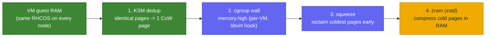
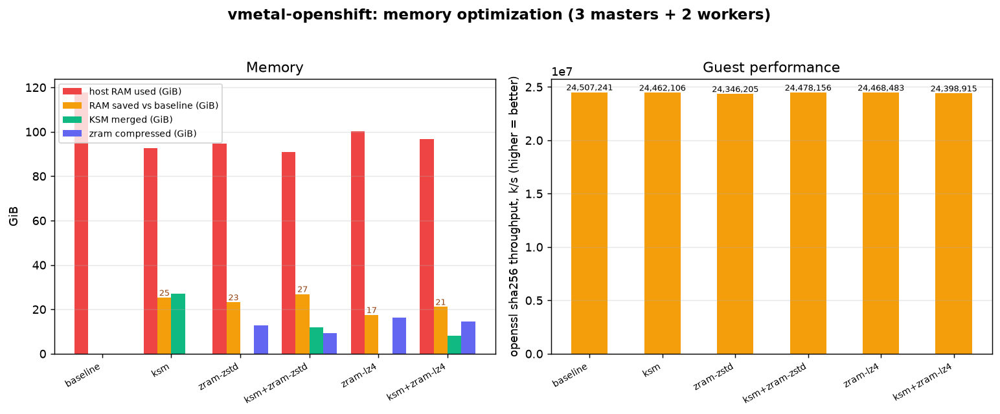

# Memory optimization (KSM + zram)

<sub>[Home](../README.md) · [Architecture](architecture.md) · [Requirements](requirements.md) · [IPI vs agent](ipi-vs-agent.md) · [Fidelity](fidelity.md) · [Disconnected](disconnected.md) · [Variables](variables.md) · [Examples](examples.md) · **Memory** · [Virtualization](virtualization.md) · [Resilience](resilience.md) · [Cloud](cloud.md) · [Troubleshooting](troubleshooting.md)</sub>

Every node boots the same RHCOS image, so most guest RAM is identical or cold.
Two host features let a cluster's nominal RAM far exceed what it actually
consumes, without touching the host OS: **KSM** (dedup) and **zram** (compress).
`make optimize` turns them on with a per-VM cgroup squeeze; `make optimize-undo`
reverts.

## The pipeline

How a page of guest RAM is handled, in order:

1. **KSM (dedup).** The kernel samepage-merging daemon scans the VMs' active RAM
   and merges identical pages (zero pages, shared libraries, the same RHCOS files
   across nodes) into one copy-on-write page. This shrinks the footprint before
   anything is compressed.
2. **cgroup wall (libvirt hook).** `hooks/qemu` intercepts each VM at launch,
   finds its transient `machine-qemu-*.scope` (cgroup v2), and caps it with
   `memory.high`. The host OS and other processes stay on raw RAM, unrestricted.
3. **The squeeze (`memory.high`).** When a VM exceeds its cap the kernel reclaims
   that VM's coldest pages early instead of OOM-killing. Reclaimed anonymous pages
   go to swap.
4. **zram (compress).** The host swap is a compressed-RAM block device (zstd by
   default). The reclaimed cold pages compress into RAM, never touching disk.

Net effect: identical pages collapse (KSM), cold pages compress (zram), and the
host kernel does it transparently per-VM.



## zram vs zswap

| | **zram** | **zswap** |
|---|---|---|
| What | a compressed RAM block device used **as swap** | a compressed **cache in front of** a real (disk) swap device |
| Backing | none, stays in RAM | needs a disk swap device; spills cold pages to it |
| Disk I/O | never | yes, on writeback / overflow |
| Pool size | up to its disksize | capped (`max_pool_percent`); overflow goes to disk |
| Use when | no disk swap, want pure-RAM density | want a RAM cache plus a disk overflow backstop |

For a single KVM host that just wants more effective RAM (no desire to hit disk),
**zram is the right choice** and is what this lab targets. Layering zswap in front
of a zram swap is pointless (double compression); pick one.

## Enable / disable

```bash
make optimize        # KSM + zram + per-VM cgroup hook
make optimize-undo   # revert (KSM off + unmerge, lift memory.high, remove hook)
```

It tunes the host (sysfs, zram, libvirt hook), so it runs with `become`: use
passwordless sudo or `make optimize ANSIBLE_ARGS="-K"` to be prompted.

`make optimize` (`optimize.yml`, `make optimize-undo` reverts) does three things:

* **KSM**: `ksmtuned` if packaged, else `run=1` directly.
* **zram**: verifies `/dev/zram0` is an active swap (creates one sized to RAM if
  the host has none and `zramctl` is available).
* **hook**: installs `hooks/qemu` to `/etc/libvirt/hooks/qemu`. On VM start it sets
  `memory.high` to `VMETAL_MEM_HIGH_PCT`% (default 60) of the VM's RAM.

Reboot the VMs (`make down` / `make up`) so the hook squeezes them.

### Persist across reboots (runtime settings reset otherwise)

* KSM: enable `ksmtuned.service`.
* zram: a `zram-generator` config at `/etc/systemd/zram-generator.conf`.
* swappiness: a `sysctl.d` drop-in (note: some distros, e.g. CachyOS, set an
  aggressive `vm.swappiness=150` at runtime that proactively swaps even with free
  RAM; lower it if you want the cluster to stay in RAM until truly pressured).

`make check` warns when KSM, zram, or the hook is off.

## Tuning knobs

| Knob | Where | Effect |
|------|-------|--------|
| `VMETAL_MEM_HIGH_PCT` | hook env (default 60) | uncompressed-RAM cap per VM; lower = more aggressive eviction to zram |
| `zram_comp` | optimize.yml var (default zstd) | zram compression algorithm |
| `vm.swappiness` | sysctl | how eagerly the kernel swaps anon pages (0 = only under real pressure) |
| `SQUEEZE_PCT` / `BENCH_ALGOS` | bench env | squeeze cap and algorithms swept in the benchmark |

## Benchmark

`make bench` (`scripts/bench/bench-memory.sh`) runs an identical CPU workload
(`openssl speed` from a UBI image) on the cluster under each setting and records
the VMs' memory + guest throughput; `tools/plot-bench.py` renders the chart.

To make the comparison honest the harness:

* measures **the VMs' actual resident memory** by summing each qemu scope's cgroup
  `memory.current`, not host `free`. `free` "used" is a whole-host figure that moves
  with page cache and tmpfs (`/tmp`, `/dev/shm`), so it does not isolate the cluster.
  The reported footprint is `vm_rss + zram_compr` (resident pages plus the cold pages
  held compressed in zram), which is the real RAM the cluster costs;
* forces `vm.swappiness=0` and `swapoff`s zram for the **baseline / KSM** states,
  so they are provably swap-free (the cluster must fit in RAM, so size it to fit);
* **unmerges** KSM (`run=2`, not just `run=0`, which leaves pages merged) and waits
  for it to drain between states;
* lets each optimization reach **steady state before measuring**: KSM scans
  aggressively to convergence then dials the scan rate down (an aggressive scan
  *during* the run cut throughput ~4x); zram fills until eviction settles;
* sweeps the zram algorithm by resetting the device (`swapoff` -> `reset` ->
  `comp_algorithm` -> `swapon`), so each algo starts from an empty device.

### Results

Measured on a 3 control-plane + 2 worker cluster (92 GiB allocated, 128 GiB host).
Footprint is the VMs' resident memory plus the cold pages held compressed in zram:



| setting | VM RSS | zram compr | **footprint** | **saved vs baseline** | KSM merged | ratio | CPU (M k/s) |
|---------|-------:|-----------:|--------------:|----------------------:|-----------:|:-----:|------------:|
| baseline | 83.6 GiB | 2.3 GiB | 85.9 GiB | n/a | 0 | n/a | 24.2 |
| KSM | 45.8 GiB | 0.3 GiB | **46.2 GiB** | **39.7 GiB** | 41.2 GiB | n/a | 24.4 |
| zram (zstd) | 29.0 GiB | 24.5 GiB | 53.5 GiB | **32.4 GiB** | 0 | **2.3×** | 24.6 |
| KSM + zram (zstd) | 28.2 GiB | 21.0 GiB | 49.2 GiB | **36.8 GiB** | 10.2 GiB | 2.3× | 24.4 |
| zram (lz4) | 27.6 GiB | 31.9 GiB | 59.5 GiB | **26.4 GiB** | 0 | 1.8× | 24.4 |
| KSM + zram (lz4) | 26.6 GiB | 29.1 GiB | 55.7 GiB | **30.2 GiB** | 9.2 GiB | 1.8× | 24.3 |

Takeaways:

* **KSM is the big win.** Deduping the identical RHCOS pages across the five nodes
  merges ~41 GiB and drops the footprint from 85.9 to **46.2 GiB (~46% less RAM)**,
  at no measurable throughput cost. For identical nodes this is the single most
  effective setting.
* **Adding zram on top of KSM does not help here** (KSM + zram-zstd is 49.2 GiB vs
  KSM alone 46.2 GiB). The cgroup squeeze evicts pages that KSM already deduped into
  compressed swap, where they still cost RAM, so the total is slightly worse than
  leaving them resident and merged.
* **zram earns its keep when nodes are not identical** (less KSM headroom) or when
  you must overcommit past RAM. zstd compresses cold pages **~2.3x** vs lz4 **~1.8x**;
  zstd is the better default. zram alone (zstd) reclaims 32.4 GiB, less than KSM's
  39.7 GiB.

### When zram beats KSM

The cluster bench above is KSM's best case: every node runs the same RHCOS image,
so the pages are byte-identical and dedup collapses them. The opposite case is
memory that is *similar in shape but not identical* (logs, sparse heaps,
partially-zeroed buffers): dedup finds no matching pages, but the content still
compresses. `make bench-zram` (`scripts/bench/bench-zram-demo.sh`) shows this directly,
host-side and with no cluster. `tools/memfill.py` allocates pages that are unique
(a per-page header, so KSM cannot merge them) but low-entropy (so zram compresses
them), marks them `MADV_MERGEABLE` so KSM does try, then a cgroup `memory.high`
squeeze pushes the cold pages into zram.

Measured (8 GiB workload, squeezed to 30%):

| mechanism | reclaimed |
|-----------|----------:|
| KSM (dedup) | **0 MiB** (every page differs) |
| zram (zstd) | **~3.8 GiB** (evicted 5.8 GiB, compressed to 2.0 GiB, ~2.9x) |

So the two mechanisms are complementary, not competing: KSM reclaims *identical*
pages, zram reclaims *compressible* ones. Identical RHCOS nodes lean on KSM;
diverse or overcommitted guests lean on zram. Running both costs little and covers
both shapes.
* **Performance is flat (~24.2-24.6M, <1.5% spread)** across all settings: at steady
  state KSM and zram cost effectively no throughput.

## Disk

The node disks are qcow2 with `cache=none` + `io=native` (direct I/O), plus
`discard=unmap` + `detect_zeroes=unmap`. Direct I/O is deliberate here: a host
page cache (`cache=writeback`) would compete for the very RAM that KSM and zram
work to free, so it is counterproductive in a memory-dense lab. If you have RAM to
spare and want faster disk, set `disk_cache: writeback` + `disk_io: threads`
(caches in host RAM, honours flushes); `unsafe` is fastest but loses data on a host
crash (fine only for a throwaway cluster). `discard`/`detect_zeroes` let the thin
qcow2 shrink as the guest frees blocks. Disk settings apply when the domain is
defined, so a running cluster needs `make down` / `make up` to pick them up.

## Caveats

* The benchmark cluster must **fit in RAM at baseline** (swap off), or the baseline
  pods cannot run. Size nodes accordingly (`master_memory_mib` / `worker_memory_mib`).
* Switching the zram algorithm requires draining the device back to RAM; if the host
  is full this fails, so the algo sweep needs headroom (the harness warns and keeps
  the current algo rather than crashing).
* These are host tunables, not part of the install. They are safe to toggle on a
  running cluster and only affect the lab VMs' cgroups, never the host OS.
