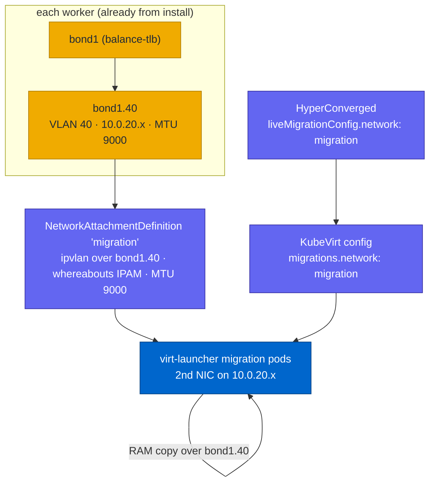

# Storage & OpenShift Virtualization

<sub>[Home](../README.md) · [Architecture](architecture.md) · [Requirements](requirements.md) · [IPI vs agent](ipi-vs-agent.md) · [Fidelity](fidelity.md) · [Disconnected](disconnected.md) · [Variables](variables.md) · [Examples](examples.md) · [Memory](memory-optimization.md) · **Virtualization** · [Resilience](resilience.md) · [Troubleshooting](troubleshooting.md)</sub>

The lab exists to run **OpenShift Virtualization (CNV)** close to a baremetal
deployment: nested virt, bonded data networks, dedicated storage + live-migration
VLANs. This is the day-2 stack that uses them.

## Storage

Two backends, both day-2 and independent:

| | `make lvms` | `make nfs` |
|---|---|---|
| Backend | LVM Storage operator on each worker's `sdc` | host NFS-Ganesha appliance + in-cluster nfs-subdir provisioner |
| StorageClass | `lvms-vg1` (default) | `nfs-rwx` |
| Access | **RWO** (node-local) | **RWX** (shared) |
| Live migration | no (disk is node-bound) | **yes** (shared) |
| Backing | the worker's dedicated 512G `sdc` | a disk-backed dir on the host (`build/nfs-export/`) |

Workers carry a dedicated empty disk (`sdc`, `worker_disks` in group_vars) so
storage stays off the OS/data disks. The NFS path treats the **KVM host as a
storage appliance** (like the FRR BGP peer): a Ganesha container exports a dir on
the machine net, and `nfs-subdir-external-provisioner` turns it into the `nfs-rwx`
StorageClass. RWX is what makes CNV VMs live-migratable.

```bash
make lvms CLUSTER=cluster0    # RWO  -> lvms-vg1 (default)
make nfs  CLUSTER=cluster0    # RWX  -> nfs-rwx (host appliance)
make nfs-down CLUSTER=cluster0
```

### Disk bus + SSD presentation

Node disks attach on a **virtio-scsi** controller (`disk_bus: scsi`, the default)
and advertise as **SSD** via `disk_rotation_rate: 1` (group_vars). So the guest
sees `/dev/sda`, `sdb`, `sdc` with `queue/rotational = 0`, at virtio speed
(virtio-scsi is paravirtual, ~virtio-blk). Two reasons it matters:

* **Ceph/ODF** reads `rotational` to set the OSD device class, so `sdc` shows up as
  an **ssd** OSD instead of hdd; SSD-gated tuning paths kick in.
* one virtio-scsi controller carries many disks on a **single PCIe slot**, so the
  6 bonded NICs no longer crowd out extra data disks (virtio-blk is one slot each).

| group_var | default | effect |
|-----------|---------|--------|
| `disk_bus` | `scsi` | `scsi` = virtio-scsi (one controller, SSD-capable); `virtio` = virtio-blk (`vdX`, no rotation_rate) |
| `disk_rotation_rate` | `1` | `1` = SSD (non-rotational); `1025`-`65535` = HDD rpm. scsi/sata only |

`rotation_rate` is a SCSI/SATA attribute, so SSD presentation requires
`disk_bus: scsi` (virtio-blk cannot set it). NVMe presentation is not offered:
it needs QEMU's emulated NVMe (slower than virtio) or PCI passthrough (real
hardware), neither worth the tradeoff in a perf-dense lab.

## OpenShift Virtualization (CNV)

```bash
make virt CLUSTER=cluster0    # kubevirt-hyperconverged operator + HyperConverged
```

Needs nested virt (the lab's host-passthrough CPUs expose `/dev/kvm` + `vmx`/`svm`
in the guests; `make check` warns if host nesting is off). The HyperConverged CR
deploys KubeVirt + CDI.

### Dedicated live-migration network

By default KubeVirt copies VM memory over the **default pod network** (here, the
machine net / `bond0`). Red Hat recommends moving that traffic to its **own
network** so a migration (which saturates a link) does not starve API, app, or
storage traffic. This lab builds the network for it and can pin migration to it.

#### Why a separate network

Live migration streams the VM's entire RAM (and dirties-pages re-copy) between
nodes. On a converged link that competes with everything else. A dedicated, jumbo
VLAN keeps it isolated and fast. The lab's `bond1.40` (storage's sibling VLAN) is
purpose-built for this.

#### What carries it: the migration VLAN

Built at install from `nic_layout` (no extra steps):

| Piece | Value | Where it comes from |
|-------|-------|---------------------|
| Bond | `bond1` (4-NIC data card, `balance-tlb`) | `nic_layout` bond1 |
| VLAN | `40`, interface `bond1.40` | `nic_layout` bond1 `vlans: migration id 40` |
| Subnet | `10.{c}.20.0/24`, jumbo MTU 9000 | `networks.migration` |
| Node IPs | `10.{c}.20.<10+node>` (static, via nmstate) | topology, applied by the agent installer |
| Scope | workers only (`bond1` is `roles: [worker]`) | role-aware NIC layout |

So every worker already has `bond1.40` with a `10.0.20.x` IP on an isolated,
jumbo VLAN. Nodes can reach each other on it out of the box (`ping -I bond1.40`).

#### How the pieces connect



1. **Node interface** `bond1.40` already exists (install).
2. **NetworkAttachmentDefinition** `migration` puts pods onto that VLAN.
3. **HyperConverged** `spec.liveMigrationConfig.network: migration` tells KubeVirt
   to use it; KubeVirt copies it to `KubeVirt spec.configuration.migrations.network`.
4. On a migration, KubeVirt gives the source + target **virt-launcher** pods a
   second NIC on the VLAN (`10.0.20.x`) and runs the libvirt migration over it.

#### The NetworkAttachmentDefinition

```yaml
apiVersion: k8s.cni.cncf.io/v1
kind: NetworkAttachmentDefinition
metadata:
  name: migration
  namespace: openshift-cnv      # also create it in the VM namespace (see note)
spec:
  config: |
    {
      "cniVersion": "0.3.1",
      "name": "migration",
      "type": "ipvlan",          # NOT macvlan - see "design choices"
      "master": "bond1.40",      # the migration VLAN interface on the node
      "mode": "l2",
      "mtu": 9000,               # match the jumbo VLAN
      "ipam": {
        "type": "whereabouts",   # cluster-wide unique IPs - see "design choices"
        "range": "10.0.20.0/24",
        "range_start": "10.0.20.100",
        "range_end": "10.0.20.200"
      }
    }
```

Range `.100-.200` stays clear of the static node IPs (`.10-.14`).

#### The HyperConverged setting

```yaml
apiVersion: hco.kubevirt.io/v1beta1
kind: HyperConverged
metadata:
  name: kubevirt-hyperconverged
  namespace: openshift-cnv
spec:
  liveMigrationConfig:
    parallelMigrationsPerCluster: 5
    parallelOutboundMigrationsPerNode: 2
    network: migration          # <- the NAD name; this is the whole switch
```

#### Design choices (why these and not the obvious ones)

* **ipvlan, not macvlan.** macvlan gives each pod NIC a new MAC; the guest vNIC's
  MAC filtering (libvirt / the bond) drops those frames, so the migration stream
  resets. ipvlan (`mode: l2`) shares the parent's MAC, so it passes.
* **whereabouts, not host-local.** `host-local` IPAM allocates per node, so two
  migration pods on different nodes can get the **same** `10.0.20.x` and collide
  on the shared VLAN. `whereabouts` is cluster-wide, so IPs are unique.
* **MTU 9000.** The VLAN is jumbo. If the NAD omits MTU, small packets pass but the
  large migration stream stalls/resets (path-MTU mismatch). Match it explicitly.
* **NAD in two namespaces.** KubeVirt attaches the network to virt-launcher pods in
  the **VM's namespace**, so the NAD must exist there too (not only in
  `openshift-cnv`). For many VM namespaces, create it in each (or templatize).

#### Enable + verify

```bash
# group_vars: cnv_migration_network: true
make configs && make virt CLUSTER=cluster0

# KubeVirt adopted it
oc -n openshift-cnv get kubevirt kubevirt-kubevirt-hyperconverged \
  -o jsonpath='{.spec.configuration.migrations.network}{"\n"}'      # -> migration

# during a migration, the target pod has a 2nd NIC on the VLAN
oc -n <vm-ns> get pod -l kubevirt.io=virt-launcher -o jsonpath='{..k8s\.v1\.cni\.cncf\.io/network-status}' | grep -A2 migration   # ips: 10.0.20.x
```

**Caveat (this lab):** it ships **off** (`cnv_migration_network: false`). In the
nested stack (ipvlan over a `balance-tlb` bond over a libvirt L2 trunk) the
migration stream is unreliable and can reset mid-copy even with the fixes above,
so the default path (machine net, validated zero-downtime) is what the lab uses.
On real hardware (a real NIC/VLAN, no nested bond-on-bridge) this is the standard,
supported isolated-migration setup.

### Live-migration test

```bash
# a VM with an RWX disk (so it can migrate) + evictionStrategy: LiveMigrate
oc apply -f - <<'YAML'
apiVersion: kubevirt.io/v1
kind: VirtualMachine
metadata: {name: testvm, namespace: vmtest}
spec:
  running: true
  template:
    spec:
      evictionStrategy: LiveMigrate
      domain:
        resources: {requests: {memory: 512Mi}}
        devices: {disks: [{name: cd, disk: {bus: virtio}}, {name: data, disk: {bus: virtio}}]}
      volumes:
        - {name: cd, containerDisk: {image: quay.io/kubevirt/cirros-container-disk-demo}}
        - {name: data, dataVolume: {name: testvm-data}}
  dataVolumeTemplates:
    - metadata: {name: testvm-data}
      spec:
        storage: {accessModes: [ReadWriteMany], storageClassName: nfs-rwx, resources: {requests: {storage: 1Gi}}}
        source: {blank: {}}
YAML

# trigger live migration and watch the node change with phase staying Running
oc apply -f - <<'YAML'
apiVersion: kubevirt.io/v1
kind: VirtualMachineInstanceMigration
metadata: {name: m1, namespace: vmtest}
spec: {vmiName: testvm}
YAML
oc -n vmtest get vmi testvm -o jsonpath='{.status.phase} {.status.nodeName}{"\n"}'
```

Validated on the 3 + 2 cluster: the VM live-migrated worker-to-worker, phase stayed
`Running` (zero downtime), with the RWX disk on the host NFS appliance. See
[resilience](resilience.md) for draining a node (VMs migrate off automatically).
